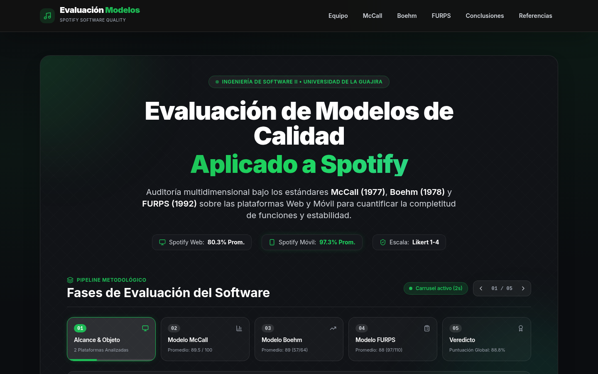
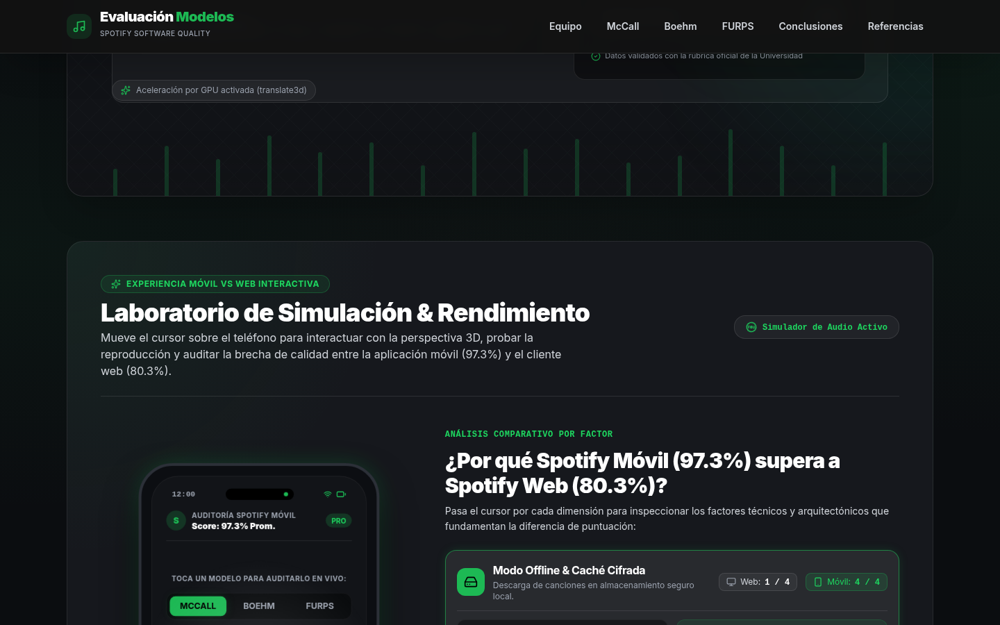
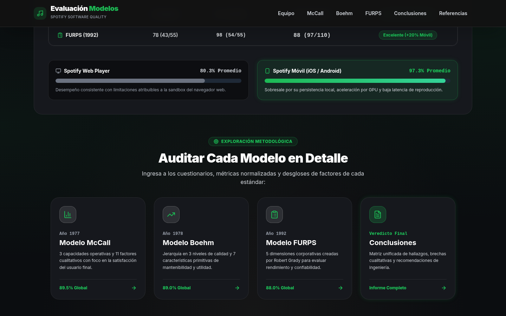
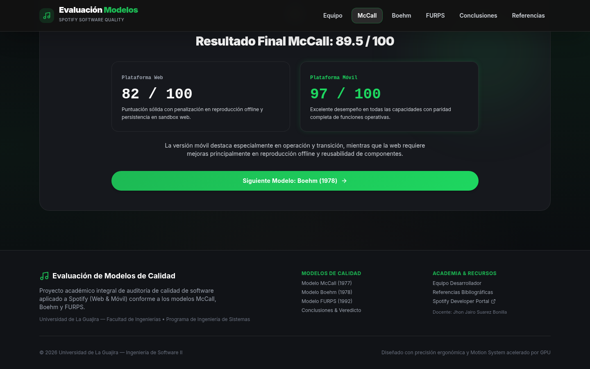
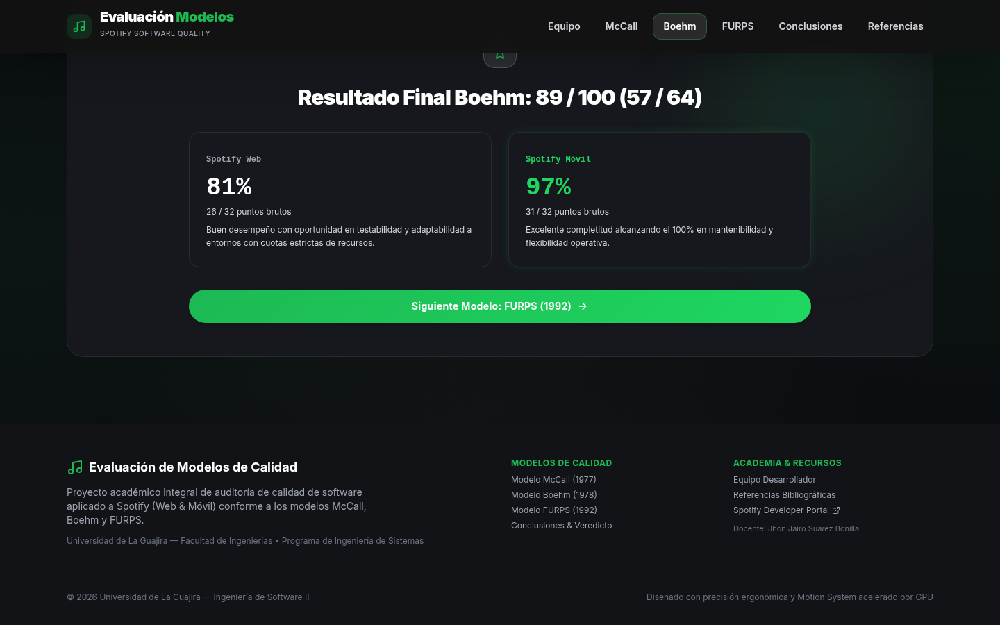
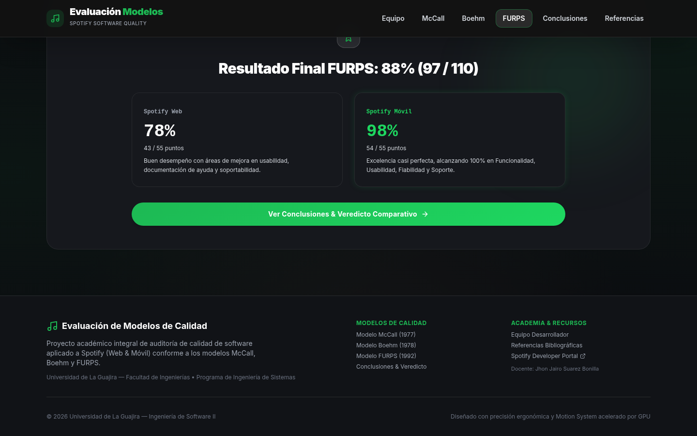
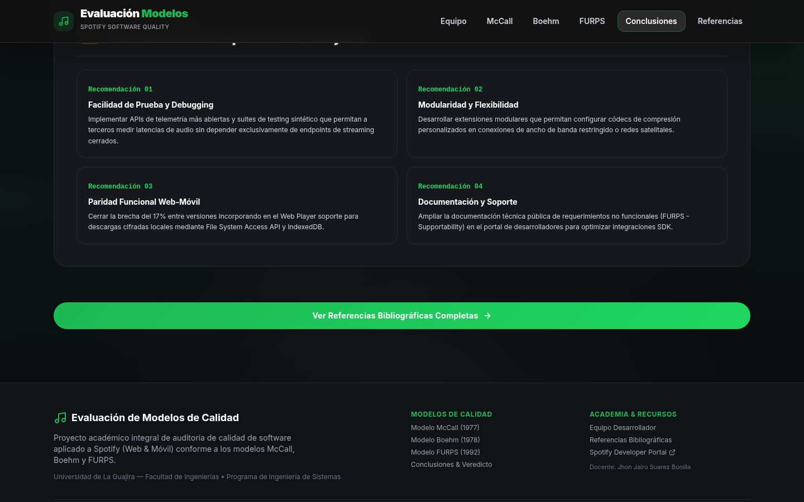
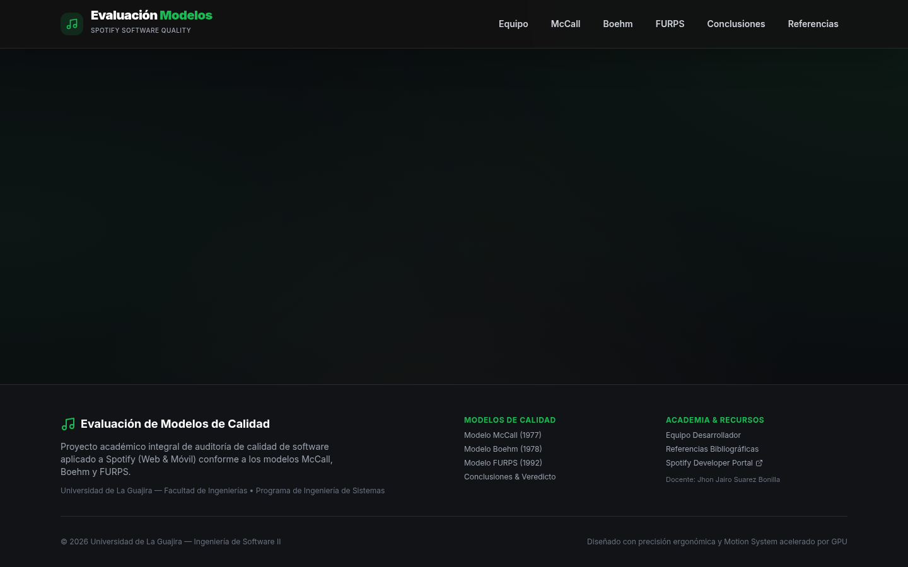
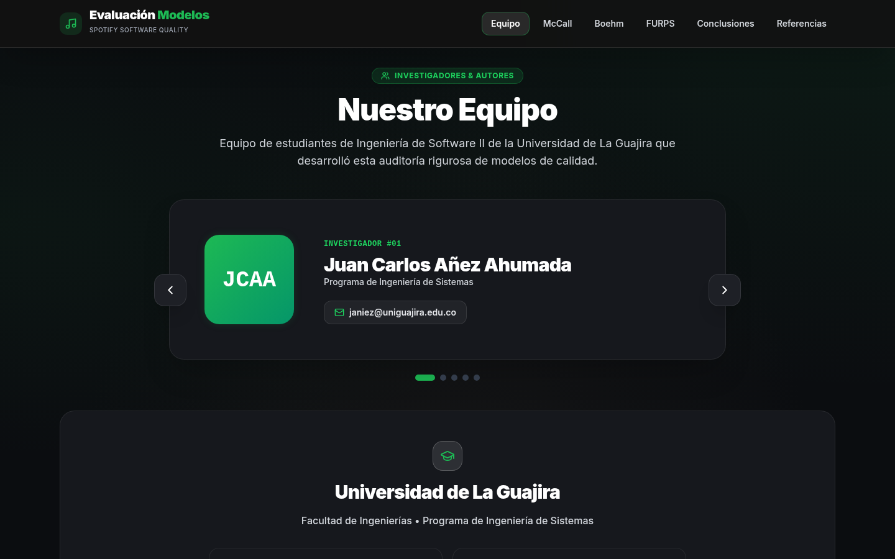
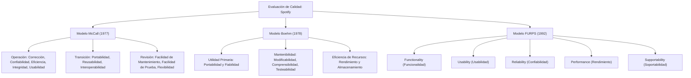

# 🎧 Evaluación de Modelos de Calidad de Software Aplicada a Spotify (Web vs. Móvil)

[](https://vitejs.dev/)
[](https://react.dev/)
[](https://tailwindcss.com/)
[](https://www.w3.org/WAI/standards-guidelines/wcag/)
[](https://playwright.dev/)
[](https://www.uniguajira.edu.co/)

> **Proyecto Académico de Auditoría y Aseguramiento de la Calidad**  
> **Asignatura:** Ingeniería de Software II  
> **Programa:** Ingeniería de Sistemas — Facultad de Ingeniería  
> **Docente:** Ing. Jhon Jairo Suarez Bonilla  
> **Institución:** Universidad de La Guajira (Riohacha, La Guajira, Colombia)

---

## 📌 Tabla de Contenidos
- [1. Descripción y Alcance del Proyecto](#1-descripción-y-alcance-del-proyecto)
- [2. Galería de Capturas del Sistema](#2-galería-de-capturas-del-sistema)
- [3. Modelos de Calidad Evaluados](#3-modelos-de-calidad-evaluados)
- [4. Veredicto y Resultados Cuantitativos](#4-veredicto-y-resultados-cuantitativos)
- [5. Características Técnicas e Interactivas](#5-características-técnicas-e-interactivas)
  - [Pipeline Metodológico con Carrusel Inteligente](#-pipeline-metodológico-con-carrusel-inteligente-auto-2s--hover-pause)
  - [Simulador de Smartphone 3D Reactivo](#-simulador-de-smartphone-3d-reactivo-al-cursor)
  - [Motion System & Parallax Acelerado por GPU](#-motion-system--parallax-acelerado-por-gpu)
  - [Scroll Restoration & Barra de Carga Neón](#-scroll-restoration--barra-de-carga-neón-superior)
  - [Auditoría de Accesibilidad & Contraste WCAG AAA](#-auditoría-de-accesibilidad--contraste-wcag-aaa)
- [6. Stack Tecnológico](#6-stack-tecnológico)
- [7. Estructura del Repositorio](#7-estructura-del-repositorio)
- [8. Instalación y Ejecución Local](#8-instalación-y-ejecución-local)
- [9. Equipo de Investigación y Créditos](#9-equipo-de-investigación-y-créditos)

---

## 1. Descripción y Alcance del Proyecto

Este proyecto consiste en una plataforma web interactiva y rigurosa diseñada para la **evaluación, cuantificación y comparación de la calidad de software** del servicio de streaming **Spotify**, contrastando dos arquitecturas de cliente:
1. **Spotify Web Player:** Cliente web basado en navegador (SPA en React / Web Playback SDK / DRM Widevine / EME).
2. **Spotify Mobile:** Aplicación nativa móvil para dispositivos Android e iOS (C++ Core nativo, caché local cifrada, aceleración por hardware).

La auditoría se implementó bajo tres marcos teóricos canónicos de la ingeniería de software:
* **Modelo McCall, Richards & Walters (1977)**: Evaluación desglosada en *Operación*, *Transición* y *Revisión*.
* **Modelo Barry Boehm (1978)**: Jerarquía de características de *Alto Nivel*, *Nivel Intermedio* y *Primitivas*.
* **Modelo FURPS / Robert Grady (Hewlett-Packard, 1992)**: Evaluación multidimensional de *Funcionalidad*, *Usabilidad*, *Confiabilidad*, *Rendimiento* y *Soportabilidad*.

---

## 2. Galería de Capturas del Sistema

A continuación se presentan capturas de pantalla reales capturadas directamente desde la aplicación:

### 🌟 01. Hero & Pipeline Metodológico con Carrusel Dinámico (Auto 2s / Hover Pause)


### 📱 02. Laboratorio 3D de Simulación Móvil & Matriz de Arquitectura Mobile vs. Web


### 📊 03. Resumen Ejecutivo y Matriz Comparativa de Modelos


### 📋 04. Auditoría Detallada — Modelo McCall (1977)


### 📈 05. Auditoría Detallada — Modelo Boehm (1978)


### 🎯 06. Auditoría Detallada — Modelo FURPS (1992)


### 🏆 07. Síntesis y Conclusiones Generales del Estudio


### 🔍 08. Visor Interactivo y Comparador de Rúbricas


### 👥 09. Equipo de Investigación y Créditos Académicos


---

## 3. Modelos de Calidad Evaluados



---

## 4. Veredicto y Resultados Cuantitativos

Todas las métricas fueron normalizadas en una escala ordinal Likert (1 a 4 puntos) y proyectadas a porcentajes estándar de conformidad de software (0% a 100%):

| Modelo de Calidad | Spotify Web | Spotify Móvil | Brecha de Calidad | Dimensión Determinante |
| :--- | :---: | :---: | :---: | :--- |
| **McCall (1977)** | `82.0%` (26/32) | `97.0%` (31/32) | **+15.0% Móvil** | Confiabilidad offline, corrección en reconexión de audio. |
| **Boehm (1978)** | `81.0%` (26/32) | `97.0%` (31/32) | **+16.0% Móvil** | Utilidad primaria y eficiencia de hardware dedicado. |
| **FURPS (1992)** | `78.0%` (43/55) | `98.0%` (54/55) | **+20.0% Móvil** | Rendimiento en background, gestión de batería y soporte OS. |
| **PROMEDIO GLOBAL** | **80.3%** | **97.3%** | **+17.0% Móvil** | **Veredicto:** Ventaja sólida del cliente móvil nativo. |

### 💡 Hallazgo de Arquitectura
Aunque **Spotify Web** democratiza el acceso sin descargas ni permisos especiales (soportando DRM en navegadores Chromium/Firefox/Safari), **Spotify Móvil** sobresale drásticamente gracias a:
* **Caché en almacenamiento local cifrado:** Descarga completa de playlists a 320 kbps (Ogg Vorbis / AAC) permitiendo reproducción 100% offline.
* **Integración profunda con el Sistema Operativo:** Handlers para audio en segundo plano (MediaSession, CarPlay, Android Auto, Audio Focus, ecualizador por hardware DSP).
* **Consumo de memoria predecible:** El cliente nativo consume entre 180MB y 250MB de RAM frente a los 650MB - 1.2GB que consume una pestaña de navegador con Chromium renderizando WebAudio y Widevine.

---

## 5. Características Técnicas e Interactivas

### ⏱️ Pipeline Metodológico con Carrusel Inteligente (Auto 2s / Hover Pause)
* **Rotación Cíclica:** Avanza automáticamente cada **2 segundos** a través de las 5 fases metodológicas: *01 Alcance & Objeto*, *02 Modelo McCall*, *03 Modelo Boehm*, *04 Modelo FURPS*, y *05 Veredicto*.
* **Pausa al Cursor:** Si el usuario coloca el ratón o interactúa con el área del carrusel (`onMouseEnter`, `onTouchStart`, `onFocusCapture`), el auto-avance se congela en tiempo real para facilitar la lectura.
* **Badge Dinámico de Estado:** Muestra un pulso verde `Auto 2s` en reproducción y un badge ámbar `Pausado (cursor dentro)` al hacer hover.
* **Barra de Progreso Reactiva:** Indicador lineal inferior de 2s animado con CSS (`@keyframes carouselProgress`) que congela su estado (`animation-play-state: paused`) sin reiniciar bruscamente.
* **Controles Circulares Manuales:** Botones Anterior / Siguiente con soporte para teclado y navegación accesible.

### 📱 Simulador de Smartphone 3D Reactivo al Cursor
* **Efecto Giroscópico Tilt 3D:** El marco del smartphone calcula el vector de distancia respecto al centro del contenedor para proyectar rotaciones realistas en `rotateX` y `rotateY` con perspectiva espacial (`perspective(1200px)`).
* **Reflejo Dinámico (Glare):** Capa radial semitransparente que viaja por la superficie de la pantalla simulando el brillo del cristal de un dispositivo premium.
* **Reproductor & Ecualizador Móvil:** Permite interactuar con botones de Play/Pause y observar barras de ecualizador sincronizadas.
* **Selector en Vivo de Modelos:** Permite alternar en tiempo real entre telemetría de McCall, Boehm y FURPS directamente en la pantalla móvil.
* **Matriz Comparativa por Factor:** Despliegue interactivo que contrasta Rendimiento, Usabilidad, Confiabilidad, Funcionalidad y Eficiencia de Batería entre Web y Móvil.

### 🎬 Motion System & Parallax Acelerado por GPU
* **Curva de Easing Orgánica:** Reemplazo de transiciones lineales por `--ease-spring: cubic-bezier(0.16, 1, 0.3, 1)`.
* **Coreografía Stagger:** Desfases escalonados (`.stagger-1` a `.stagger-8`, 50-100 ms) para revelar tarjetas y listas de métricas fluidamente.
* **Parallax Fluido:** Desplazamiento diferencial de orbes esmeralda y patrones vectoriales de audio mediante transformaciones 3D aceleradas (`transform: translate3d`) limitando repintados con `will-change: transform`.
* **Accesibilidad `prefers-reduced-motion`:** Detección de la preferencia del usuario en el sistema operativo para desactivar transiciones complejas si el usuario es sensible al movimiento.

### 🔄 Scroll Restoration & Barra de Carga Neón Superior
* **Scroll Restoration:** Restaura la posición exacta de desplazamiento al utilizar los botones de Atrás / Adelante del navegador (`history.action === 'POP'`) y conduce suavemente a `(0, 0)` en rutas nuevas.
* **Top Loading Bar:** Barra superior con resplandor neón `#1DB954` y animación fluida que comunica visualmente las transiciones entre páginas.

### ♿ Auditoría de Accesibilidad & Contraste WCAG AAA
* Se corrigieron exhaustivamente problemas de contraste donde encabezados oscuros se mimetizaban con el fondo.
* Paleta Spotify Dark unificada:
  * **Fondo Base:** `#0b0d10`
  * **Superficies de Tarjetas:** `#16181d` con bordes sutiles `border-white/10`
  * **Tipografía Primaria:** `text-white` (`#ffffff`) — Relación de contraste > 15:1 (Supera WCAG AAA).
  * **Tipografía Secundaria:** `text-gray-300` / `text-gray-400` — Relación de contraste > 7:1.
  * **Acentos:** Verde Spotify `#1DB954` y `#1ed760`.
* Verificado con auditorías automatizadas en modo headless mediante **Playwright CLI**.

---

## 6. Stack Tecnológico

| Capa | Tecnología | Propósito |
| :--- | :--- | :--- |
| **Framework UI** | React 19 (`react`, `react-dom`) | Renderizado declarativo y gestión de componentes |
| **Tooling & Bundler** | Vite 7 (`@vitejs/plugin-react`) | HMR ultra rápido y empaquetado optimizado |
| **Enrutamiento** | React Router DOM 7 (HashRouter) | Navegación SPA compatible con GitHub Pages |
| **Estilos & Layout** | Tailwind CSS 3.4 + PostCSS | Sistema de diseño utilitario, grid y flexbox |
| **Iconografía** | Lucide React | Iconos vectoriales limpios y accesibles |
| **Testing E2E** | Playwright CLI (`headless`) | Auditoría de DOM, interacción y capturas visuales |
| **Despliegue** | GitHub Pages (`gh-pages`) | Publicación continua en producción |

---

## 7. Estructura del Repositorio

```text
evaluacion-modelos-spotify/
├── docs/
│   └── screenshots/              # Capturas de pantalla de alta resolución para el README
│       ├── 01-home-hero-pipeline.png
│       ├── 02-interactive-device-showcase.png
│       ├── 03-home-models-summary.png
│       ├── 04-model-mccall.png
│       ├── 05-model-boehm.png
│       ├── 06-model-furps.png
│       ├── 07-conclusions.png
│       ├── 08-visor-interactivo.png
│       └── 09-equipo.png
├── public/                       # Recursos estáticos y logos
├── src/
│   ├── components/               # Componentes modulares reutilizables
│   │   ├── Footer.jsx
│   │   ├── HomeHeroPipeline.jsx           # Hero Parallax + Carrusel 2s con Hover Pause
│   │   ├── InteractiveDeviceShowcase.jsx  # Smartphone 3D Tilt + Comparador Mobile vs Web
│   │   ├── Navbar.jsx
│   │   ├── QuestionList.jsx
│   │   ├── ScoreCard.jsx
│   │   ├── ScrollRestoration.jsx          # Restauración inteligente de historial de scroll
│   │   └── TopLoadingBar.jsx              # Barra neón de progreso en navegación
│   ├── hooks/                    # Custom React Hooks
│   │   ├── usePrefersReducedMotion.js     # Detección de accesibilidad reducida
│   │   └── useScrollParallax.js           # RAF scroll tracker acelerado por hardware
│   ├── pages/                    # Vistas completas de la aplicación
│   │   ├── BoehmPage.jsx
│   │   ├── Conclusions.jsx
│   │   ├── FurpsPage.jsx
│   │   ├── Home.jsx
│   │   ├── McCallPage.jsx
│   │   ├── Referencias.jsx
│   │   ├── Team.jsx
│   │   └── Visor.jsx
│   ├── App.jsx                   # Enrutamiento principal y layout global
│   ├── index.css                 # Variables de diseño Spotify, keyframes y easing
│   └── main.jsx                  # Punto de entrada de la aplicación
├── tailwind.config.js            # Configuración de tema, sombras de brillo y animaciones
├── vite.config.js                # Configuración de Vite con base path para GitHub Pages
└── package.json                  # Dependencias y scripts de compilación
```

---

## 8. Instalación y Ejecución Local

### Prerrequisitos
* **Node.js**: Versión `18.x` o superior (`20.x` recomendada).
* **npm**: Versión `9.x` o superior.

### Pasos de Instalación

1. **Clonar el repositorio:**
   ```bash
   git clone https://github.com/ivnmtz09/evaluacion-modelos-spotify.git
   cd evaluacion-modelos-spotify
   ```

2. **Instalar dependencias:**
   ```bash
   npm install
   ```

3. **Iniciar el servidor de desarrollo:**
   ```bash
   npm run dev
   ```
   Abre tu navegador en `http://localhost:5173/evaluacion-modelos-spotify/`.

4. **Compilar para producción:**
   ```bash
   npm run build
   ```
   Genera los archivos optimizados listos para despliegue en la carpeta `dist/`.

5. **Desplegar a GitHub Pages (opcional):**
   ```bash
   npm run deploy
   ```

---

## 9. Equipo de Investigación y Créditos

Proyecto desarrollado por estudiantes de **Ingeniería de Sistemas** de la **Universidad de La Guajira**:

* 👨‍💻 **Juan Carlos Añez Ahumada** — [janiez@uniguajira.edu.co](mailto:janiez@uniguajira.edu.co)
* 👨‍💻 **Jesus Manuel Arias Deluque** — [jmanuelarias@uniguajira.edu.co](mailto:jmanuelarias@uniguajira.edu.co)
* 👨‍💻 **Ivan Jesus Martínez Molina** — [ijesusmartinez@uniguajira.edu.co](mailto:ijesusmartinez@uniguajira.edu.co)
* 👨‍💻 **Sebastián David Ramos Jaraba** — [sdramos@uniguajira.edu.co](mailto:sdramos@uniguajira.edu.co)
* 👨‍💻 **Stiven David Silva Toro** — [sssilva@uniguajira.edu.co](mailto:sssilva@uniguajira.edu.co)

**Dirección Académica:**
* 🎓 **Docente:** Ing. Jhon Jairo Suarez Bonilla
* 🏛️ **Asignatura:** Ingeniería de Software II
* 📍 **Institución:** Universidad de La Guajira (Riohacha, Colombia)

---

<div align="center">
  <sub>Diseñado con dedicación académica y pasión por el aseguramiento de la calidad de software. Licencia MIT.</sub>
</div>
